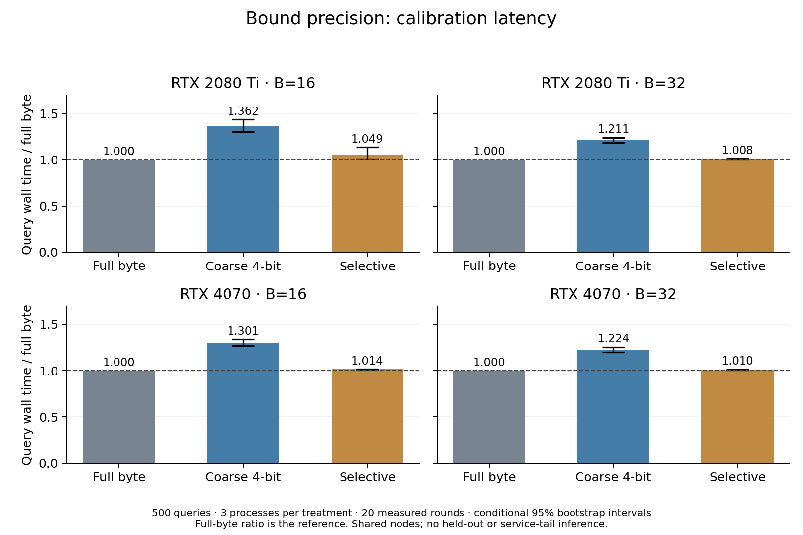

# Bound precision: results and interpretation

Measured source: `07d499067c261c4265db2373c0ec6bcaceb2b781`. Parent: approved PR #9 merge `fe0d4b7`. Code and protocol were committed privately before compute; this public package follows execution and does not claim earlier public preregistration.

## Question and controlled treatments

Does a smaller conservative bound representation or selective low-nibble refinement improve the validated full-byte CSR pruning path? Full byte stores exact maxima. Coarse stores packed high nibbles and uses `L=16*sum(weight*high)`, `U=L+15*sum(weight)`. Selective skips `U<tau`, accepts `L>=tau`, and refines only `L<tau<=U`. Zero maxima retain interval [0,15]. The lower endpoint is not a document-score witness and never raises tau.

Scoring, original numeric-ID ties, all-passage eligibility, the first-16-block witness seed, CSR scorer and hierarchical GPU top-k remain fixed. Selective uses an extra uncertainty compaction/count copy and conditional refinement before final compaction; all of that overhead is timed. Coarse may retain extra blocks; selective survivors must match full byte.

## Validation and timing

Each GPU passed 192 synthetic native configurations, six 500-query paired safety cohorts, 18 independent timing processes and 16 separately checked profiles. The deliberate wrong-precision configuration was rejected before query compute once per host. Local hash/oracle/output replay validates all **842,720 output groups** across the study. Host engineering checks cover 395,264 cases and 561 packed slots per architecture; these are build/test observations, not retrieval timings.

Timing uses 1M passages, k=10, 500 calibration queries, B16/B32, three processes per treatment/B, three warmup rounds and twenty measured rounds. Precision orders are cyclic [0,1,2], [1,2,0], [2,0,1], with alternating B order. The primary statistic is the geometric mean of query-wise pruned median latency ratios against full byte, equally weighted over queries/processes. Intervals use 10,000 crossed query/process bootstrap draws, seed 20261111, and are conditional on this calibration study.

The wall boundary includes host weight construction, uploads/reset, real seed scoring/selection, bounds, all compactions and count transfers, survivor scoring, global selection and winner copy. It excludes index/maxima/packing setup, the runtime gate, CPU oracle/validation, diagnostic threshold copy and file I/O.

## Latency

Ratios above 1 mean higher latency than full-byte pruning.

| GPU | B | Coarse/full latency (95% interval) | Selective/full latency (95% interval) |
|---|---:|---:|---:|
| RTX 2080 Ti | 16 | 1.3616 [1.3004, 1.4347] | 1.0493 [1.0066, 1.1352] |
| RTX 2080 Ti | 32 | 1.2105 [1.1842, 1.2388] | 1.0080 [1.0046, 1.0106] |
| RTX 4070 | 16 | 1.3009 [1.2668, 1.3374] | 1.0144 [1.0134, 1.0153] |
| RTX 4070 | 32 | 1.2239 [1.1969, 1.2529] | 1.0096 [1.0085, 1.0109] |

Own-control-normalized sensitivity is a separate descriptive contrast, with no additional interval claimed:

| GPU | B | Coarse normalized ratio | Selective normalized ratio |
|---|---:|---:|---:|
| RTX 2080 Ti | 16 | 1.3199 | 1.0099 |
| RTX 2080 Ti | 32 | 1.2079 | 1.0068 |
| RTX 4070 | 16 | 1.2999 | 1.0148 |
| RTX 4070 | 32 | 1.2241 | 1.0094 |

## Memory and explanation

Tracked application allocation peaks in bytes, identical on both GPUs. These are separate first-25 diagnostic processes and exclude CUDA context, driver and profiler overhead. Paired timing controls share treatment metadata and cannot establish standalone control memory.

| B | Unpruned control | Full byte | Coarse | Selective |
|---|---:|---:|---:|---:|
| 16 | 619,738,009 | 2,413,428,641 | 1,517,209,891 | 2,413,678,641 |
| 32 | 619,613,009 | 1,516,459,395 | 1,068,350,020 | 1,516,584,395 |

Coarse bounds halve the bound plane but increase scored blocks by 33.63% at B16 and 24.09% at B32 over the 500-query safety cohort. Primary latency increases by 21.05–36.16%. The standalone application-buffer peak falls by 37.13%/29.55% relative to full-byte pruning, while remaining above the unpruned control. This is a memory/latency tradeoff for this conservative nibble encoding.

Selective refinement reads low nibbles for 29.28%/23.19% of nonseed blocks at B16/B32 and preserves exactly the full-byte survivor schedule. Primary latency increases by 0.80–4.93%; all conditional primary intervals lie above 1. Turing B16 is sensitive to process variation: its direct ratio is 1.04935, while the own-control-normalized ratio is 1.00986. The entire direct difference should not be attributed to refinement overhead alone.

Separate first-25-query profiles place full-bound kernels at 0.18–0.37% of pruned kernel duration. Coarse kernel DRAM reads increase by about 19–31%; selective kernel DRAM reads remain within 0.15% of full byte. These diagnostic quantities exclude transfers, memsets, CPU work and stream gaps and do not measure full-query traffic. The results support prioritizing scoring/payload layout and a strong external comparison over further bound-only optimization in this CSR design. They do not reject progressive precision in every layout or workload.

## Evidence, limitations and next action

The [canonical results](../../results/2026-11-11-cuda-bound-precision/README.md) contain per-query timing/winners, runtime settings, build/version/monitor logs, manifests, checked trace/counter exports and independent analyses. Detailed fixture outputs are in lossless per-host ZIPs with member hashes and a 193-attempt index. Full profiler reports, binaries, bulk indexes and private workflow/session/authentication files remain outside Git with custody hashes.

All 36 ordinary timing monitor logs contain no sampled simultaneous target compute contexts. This is not proof of exclusive GPU use; clocks/cache/shared-node effects remain uncontrolled. Bulk index bytes are bound by runtime input hashes and were not duplicated into the local/public package. Statistical recomputation agrees within 1e-12 relative tolerance across Linux/Windows; labels, counts, membership and seeds remain exact. No held-out query weights/results were used, and no original-model FP32, serving-tail or external-superiority claim follows.

Retain full byte as the CSR latency reference; retain coarse as the measured memory/latency alternative and selective as a negative latency result. Next: contract-aligned released GPUSparse, scoring/payload-layout evidence and broader supported workloads, followed by a recorded freeze and held-out evaluation. Follow-on code branches start from reviewed, updated main. Teammate task owners remain unassigned until agreed.
