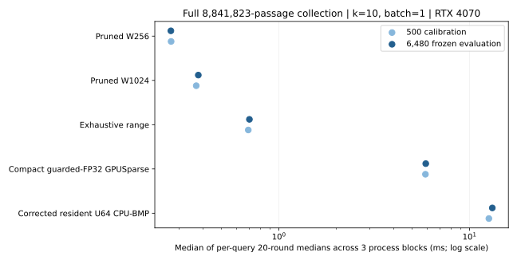

# Matched full-collection controls and frozen evaluation

Accepted calibration and independently replayed evaluation use all **8,841,823 passages**. Frozen W256 has a 0.271063 ms evaluation median; W1024 has a 0.377547 ms median and smaller p95/p99. The primary paired geometric speed ratios are 19.52x against compact guarded-FP32 GPUSparse and 45.45x against corrected resident U64 CPU-BMP. These are bounded integer-domain system comparisons on one shared RTX4070 host, with a disclosed interrupted continuation. They are not unrestricted floating-model, unmodified released-BMP or strongest-CPU-baseline claims.

## Data, systems and timing

The 500 calibration queries selected the frozen primary W256/S64/T256 and secondary tail W1024/S64/T256 configurations. Evaluation uses all 6,480 reserved queries after method/settings/split/analysis freeze METHOD03. Other controls are exhaustive range W1024/T256, compact uint8-storage guarded-FP32 GPUSparse BLOCK_PL512, and corrected CPU-BMP raw B32, alpha=beta=1, Rayon1, CPU0/local NUMA. All use k=10, batch=1,3 process blocks, 3 warmups and 20 measured rounds. CPU and GPU stages execute sequentially. No heldout query was dropped or used to tune the frozen systems.

The common boundary starts with resident parsed cap32 term/weight pairs and ends with ordered original numeric-ID/integer-score top-k in host memory. Fresh query preparation/cursors, retrieval, selection, transfers and synchronization are included. Index load/upload, file decoding, domain verification and textual formatting are excluded. CPU token-string preparation versus GPU numeric-feature representation remains disclosed. This is retrieval latency, not complete serving/request latency or index-build cost.

## Results

| System | Calibration median ms | Frozen-evaluation median ms | Evaluation p95 ms | Evaluation p99 ms |
|---|---:|---:|---:|---:|
| Pruned W256 | 0.271837 | 0.271063 | 0.967323 | 1.628266 |
| Pruned W1024 | 0.368284 | 0.377547 | 0.797049 | 0.992293 |
| Exhaustive range | 0.690613 | 0.700009 | 0.971586 | 1.092822 |
| Compact guarded-FP32 GPUSparse | 5.871430 | 5.893761 | 8.105368 | 8.615398 |
| Corrected resident U64 CPU-BMP | 12.635464 | 13.171208 | 35.897945 | 63.482064 |

Each descriptive observation is a query's median of 20 rounds in one process; summaries pool the three assigned blocks. The following contrasts instead use paired log time ratios by query/block. They are **not ratios of system medians**. The frozen estimator uses 10,000 crossed process/query bootstrap draws, Python MT19937 seed 20261118, shared query samples across resampled blocks and linear 2.5/97.5 percentiles; speed-ratio intervals invert and reverse time-ratio endpoints. Individual conditional 95% intervals have no familywise coverage guarantee.

| GPU system versus control | Paired geometric speed ratio (control/GPU time) | Conditional 95% interval | Role |
|---|---:|---:|---|
| Pruned W256 versus compact | 19.5224x | 19.2441 to 19.8132x | primary |
| Pruned W256 versus U64 BMP | 45.4465x | 43.8515 to 46.7280x | primary |
| Pruned W1024 versus compact | 15.9194x | 15.7443 to 16.0992x | secondary |
| Pruned W1024 versus U64 BMP | 37.0590x | 35.7912 to 38.1010x | secondary |
| Pruned W256 versus range | 2.3845x | 2.3543 to 2.4160x | secondary |
| Pruned W1024 versus range | 1.9444x | 1.9271 to 1.9623x | secondary |

The frozen W256 primary median-latency choice remains; its evaluation p99/max exceed exhaustive range, so it is not uniformly faster on every query. W1024 remains a tail/memory tradeoff. Sampled own GPU peaks were 4,828 MiB (W256), 3,730 MiB (W1024), 3,668 MiB (range), and 5,322 MiB (compact). These are whole-process sampled observations, not exact allocation peaks or CPU memory measurements. Neither the observed medians nor these intervals establish a production SLA or a population-wide hardware-independent gain.

## Independent validation and arithmetic qualification

Independent replay checked **22,680,000 ranked scores**, all 5 correctness runs, all 15 eligible timing processes and one deliberate pre-compute runtime rejection. Every ordered ID and integer score matched the independent full-collection U64 oracle. Oracle construction/returned-row score replay are retained in the original sealed evidence. All 20 executed scoring runtime schemas/behaviors and non-query-derived settings match the frozen templates. All timings retain resource/ownership/CPU/swap monitoring and BMP measured-iowait checks.

The source/build audit verified 159 Git source bindings across the two snapshots,21 private support bindings,178 runner artifact hashes,441 source-archive file bindings,17 unchanged compiled-binary bindings,241 carry-forward bindings and 4 compact JIT scoring scopes. Binary/compiler provenance is explicitly reused from preparation05, not claimed rebuilt at continuation. Hash checks bind bytes; they do not prove build causality. JIT physical inspection is not an instruction trace.

Eighteen claim-time comparison records retain all differences. Six same-U32 comparisons are mechanically REVIEWABLE; **twelve compact/BMP comparisons remain mechanically BLOCKED** by arithmetic/contract labels. No policy override hides these blocks. The scoped system comparison additionally relies on uint8 impacts, unique document/query terms, cap32 weights, <=128 terms and 255*sumweights<2^24. Thus every nonnegative FP32 product/partial sum is exactly representable and the guarded U32/U64 paths produce the same integers, with canonical numeric original-ID ties independently replayed. This does not extend to arbitrary floating query/model weights or equality of physical arithmetic.

## Interruption, resource eligibility and provenance

Original frozen03 completed correctness and the first 8 eligible timings, then stopped during a BMP warmup attempt with own swap 1,095,532 KiB above the 1 GiB limit and no final runner JSON. Its historical exit/allocation cause remains unknown; a secondary JSON error is not proof of OOM. Earlier resource-ineligible attempts remain excluded and preserved. The continuation ran only the seven missing fixed slots; no oracle/correctness/accepted timing was rerun or chosen by speed. Accepted timing records span 2026-11-19T23:16:34 UTC to 2026-11-20T09:39:41 UTC. Block 1 crosses the interruption; the full per-stage schedule is saved in timing-schedule.json. These are assigned-block, session-spanning conditional comparisons, not a fresh uninterrupted same-session experiment. CPU-BMP process medians were 12.722839, 13.356925, and 13.493980 ms; session variation remains a limitation even after resource eligibility checks.

Admission and sampled monitoring require the target RTX4070, no foreign GPU contexts, >=10000MiB GPUfree, >=34GiB hostMemAvailable, <=4other CPU cores, BMP measured-iowait<=1% and own swap<=1GiB. Gates are not an exclusive scheduler reservation or proof of continuously uncontended CPU/GPU access. Never interfere with another user's process.

Measured backend/calibration source:`61c8a00d8323d49a011d8909113a8755906323c9`. Original heldout orchestration:`79a9c11d644b7d681046704e62deb7159a136ed8`. Continuation orchestration:`51a0158fc11f127d51e553e7ccea9b03ba39bc14`. Numerical backends and scientific settings did not change. Calibration06 archiveSHA256:`ba3b39d527e2110b10630639613681d5fadcd59c8f4b63481e86ce39fbe4ed7b`; interrupted archive:`e0feb7f6bb611693d50c2f5d61b0cdbb5434abf880f2785cf758c8e631a269c8`; continuation archive:`0cc73ed80f9cb52de187e78a6d8b3053c837d0b8363cea82d93112e389af815f`. Full sealed archives/raw evidence are preserved locally; bulk artifacts are not embedded in Git. RAW-ARTIFACTS.json provides raw file identities.

## Decision and remaining scope

Accept the frozen supported-domain evaluation, retain all historical failures/exclusions, and close this study without changing its selected systems. Guarded U32 CPU-BMP is a separate unimplemented/unmeasured follow-on question addressing the current U64 control limitation; it is not assumed faster. Future development uses 500 calibration queries. The 6,480 evaluation queries are now exposed; any reuse is follow-up evaluation, not new untouched confirmation.

Arnav receives core range/V2 credit; Parva pruning/profiling/BMP credit. This study contributes matched controls and validation evidence, not a claim of a new retrieval kernel or literature-wide novelty. Team ownership of future work remains unassigned until agreed.

## Reproduction

Use the frozen experiment configs and source reviews under experiments/2026-11-18-matched-final-evaluation/. Rebuild only from the recorded source/toolchain or verify the explicitly reused preparation05 binaries. Obtain inputs by pinned hash, register fresh run directories and use the runtime-gated runner. The frozen analyzer analysis/analyze_heldout.py reads raw_directory per manifest entry; local replay used a derived path-only manifest view and left sealed bytes unchanged. Analysis JSON, claim comparisons, provenance audit, template replay, schedule and raw-artifact catalog accompany this report. Do not relaunch existing controllers or overwrite historical outputs.
